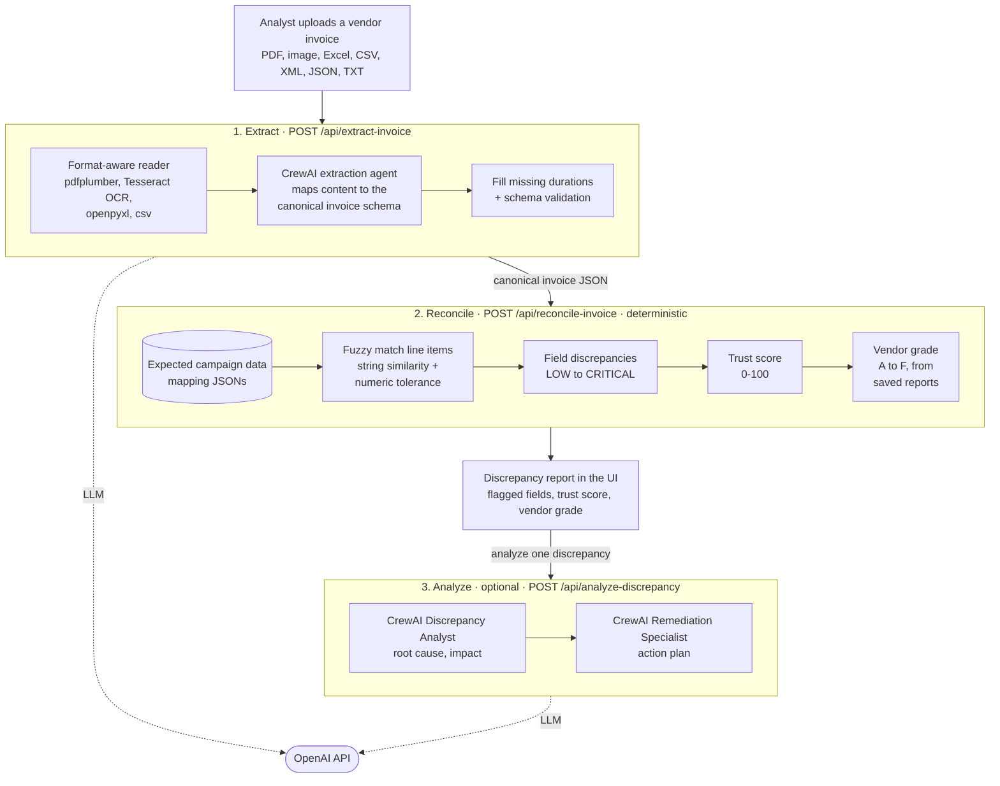
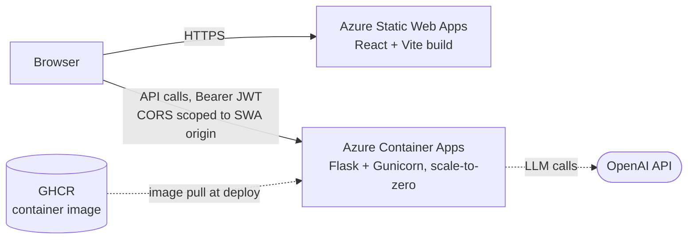

# Media Billing Reconciliation Platform

An AI-powered web application that ingests media invoices, normalizes them to a canonical schema, and reconciles them against expected campaign data. Discrepancies are surfaced with severity, reasoning, and remediation suggestions.

Built originally as a hackathon prototype, then hardened with real auth, scoped CORS, and a containerized deploy on Azure free tier.

## Run it locally

Requires Python 3.11+, Node 20+ and an OpenAI API key. All invoice data in this repo is synthetic sample data.

```bash
# Backend (http://localhost:5000)
cd backend
python3 -m venv ../venv && source ../venv/bin/activate
pip install -r requirements.txt
cat > .env <<'ENV'
OPENAI_API_KEY=sk-...
JWT_SECRET=any-long-random-string
AUTH_USERS={"demo@example.com":"<werkzeug password hash>"}
ENV
python app.py

# Frontend (http://localhost:3000), in a second terminal
cd frontend
echo "VITE_API_BASE_URL=http://localhost:5000/api" > .env.local
npm install && npm run dev
```

Generate the password hash with `python -c "from werkzeug.security import generate_password_hash; print(generate_password_hash('your-password'))"`. More detail in [backend/README.md](backend/README.md) and [frontend/README.md](frontend/README.md).

To deploy on Azure free tier (Static Web Apps + Container Apps), follow the numbered scripts in [deploy/](deploy/); `99-teardown.sh` removes everything. The demo deployment has been torn down.

---

## Problem Statement

Media agencies handle thousands of vendor invoices each month across TV, digital, and programmatic channels. Manual reconciliation against campaign plans is slow, inconsistent, and prone to costly errors.

The platform automates four steps that previously consumed days of analyst time:

1. **Ingest** vendor invoices in any common format (PDF, image, CSV, Excel, XML, JSON, TXT).
2. **Extract** structured fields using AI agents.
3. **Normalize** vendor-specific layouts to a canonical schema.
4. **Reconcile** invoice data against expected campaign data and surface discrepancies.

---

## System Design

### High-level architecture

An invoice goes through three stages. Only extraction and the optional analysis use an LLM; matching and scoring are deterministic.



### Deployment



### Why this shape

| Choice | Reason |
|---|---|
| **Single-page React** with Vite | Fast iteration, good DX, builds to static assets that any CDN can serve. |
| **Stateless Flask backend in a container** | Reconciliation logic is CPU-bound and stateless. No need for stickiness or shared memory. |
| **Scale-to-zero on Container Apps** | Free under quota for demo traffic. Cold-start cost (~10 to 20 sec) is acceptable for an internal tool. |
| **Mapping data baked into the image** | No database, no external blob fetches, no startup config. Self-contained container. |
| **JWT against env-defined users** | Real auth boundary without standing up an identity service. Right-sized for a closed-audience demo. |
| **Ephemeral `/tmp` for uploads** | Project rule forbids persistent storage. Acceptable for the demo. Each session is independent. |

### Backend internals

The Flask app is intentionally thin. It routes requests to four service modules:

| Module | Responsibility |
|---|---|
| `services/auth.py` | JWT issuance, request validation decorator, in-memory rate limit |
| `services/invoice_extractor.py` | File-to-canonical-JSON pipeline. Calls into `utils/file_parsers.py`. |
| `services/invoice_reconciliation.py` | Fuzzy match against mapping data, trust score, vendor performance grade |
| `services/discrepancy_agent.py` | CrewAI multi-agent reasoning for individual discrepancies |
| `utils/file_parsers.py` | Format-aware parsing: PDF (pdfplumber), images (pytesseract OCR), XLS/XLSX (openpyxl), CSV / XML / JSON / TXT |

This separation lets the reconciliation engine evolve independently of the AI features. AI calls are lazy: importing the discrepancy agent does not load CrewAI until a route actually uses it.

### Frontend internals

```
src/
├── components/
│   ├── Login.tsx               JWT-backed authentication form
│   ├── InvoiceExtractor.tsx    Upload + extraction view
│   ├── DiscrepancyReport.tsx   Top-level findings + AI analysis modal
│   ├── DiscrepancyReview.tsx   Per-line drill-down
│   └── Header.tsx, Footer.tsx
├── services/
│   ├── auth.ts                 Token storage, axios interceptors, 401 redirect
│   └── campaignAPI.ts          API client wrappers
├── context/ThemeContext.tsx    Light/dark theme
├── App.tsx                     Routes + <Protected> guard
└── main.tsx                    Entrypoint
```

`<Protected>` checks for a token before rendering `/extractor`, `/review`, `/report`. Axios interceptors inject the bearer token on every request and trigger logout on 401.

---

## Process Flow

A typical reconciliation cycle.

```
1. Login
   - User submits credentials at /login.
   - Backend verifies against AUTH_USERS, returns JWT.
   - Frontend stores token in sessionStorage.

2. Upload
   - User drags a vendor invoice into the extractor.
   - Frontend posts the file to /api/extract-invoice.
   - Backend's universal parser detects format, extracts text or
     structured rows, runs CrewAI to map fields into the canonical
     invoice schema.
   - Result rendered side-by-side: header info + line items + notes.

3. Reconcile
   - User clicks "Run Reconciliation".
   - Frontend posts the canonical invoice JSON to /api/reconcile-invoice.
   - Backend loads mapping JSONs, runs fuzzy matching across line items,
     produces field-level discrepancies, trust score, and vendor grade.

4. Review and Analyze
   - Discrepancy report shows every flagged field with severity:
     LOW < MEDIUM < HIGH < CRITICAL.
   - User clicks "Analyze" on any discrepancy.
   - Backend invokes a CrewAI crew (analyst + remediation specialist)
     to produce reasoning and a step-by-step action plan.
```

---

## Reconciliation Logic

The core engine is deterministic fuzzy matching with weighted scoring.

### Field-level matching

| Field | Strategy | Threshold or Tolerance |
|---|---|---|
| Campaign name | String similarity (SequenceMatcher) | 0.80 |
| Insertion order ID | String similarity | 0.90 |
| Booked impressions | Numeric percent diff | 5% |
| Billed impressions | Numeric percent diff | 5% |
| Net cost | Numeric percent diff | 5% |
| Duration in days | Computed from date range | 5% |
| Ad unit / format / geo | String similarity | 0.80 |

Each field carries a weight. Numerical fields like `net_cost` and `billed_impressions` weigh more than ad-unit text.

### Line-item match score

Per-line score is the **weighted average** of all matched field scores. Line items below 0.7 land in `no_match_found`. Above 0.7 with field-level discrepancies generate per-field severity:

| Percent difference | Severity |
|---|---|
| < 15% | LOW |
| 15 to 35% | MEDIUM |
| 35 to 50% | HIGH |
| >= 50% | CRITICAL |

### Trust score

Whole-invoice metric (0 to 100). Starts at 100, deducts based on severity counts, adds bonus for high-confidence matches. Maps to a level: EXCELLENT, GOOD, FAIR, POOR, CRITICAL.

### Vendor performance grade

Aggregates discrepancy history across past invoices for the same vendor. Same scoring formula, different scope. Renders as a vendor card in the report (A, B, C, D, F).

### AI reasoning layer (optional)

When a user asks for analysis on a specific discrepancy, two CrewAI agents activate:

1. **Discrepancy Analyst**: identifies root cause, financial impact, risk pattern.
2. **Remediation Specialist**: produces a structured action plan with immediate, follow-up, and prevention items.

This layer is opt-in per discrepancy to control OpenAI cost.

---

## Tools and Tech Stack

### Frontend

| Tool | Role |
|---|---|
| React 18 | View layer |
| TypeScript | Type safety |
| Vite 5 | Dev server + build |
| React Router 7 | Client-side routing |
| Axios | HTTP client + interceptors |

### Backend

| Tool | Role |
|---|---|
| Python 3.11 | Runtime |
| Flask 3 + Flask-CORS | HTTP framework |
| Gunicorn | Production WSGI server |
| CrewAI 1.x | Multi-agent orchestration |
| OpenAI Python SDK | LLM client |
| langchain-openai | ChatOpenAI wrapper used by CrewAI agents |
| PyJWT | Token signing and verification |
| Werkzeug | Password hashing (scrypt) |
| pdfplumber | PDF text extraction |
| pytesseract + tesseract-ocr | Image OCR |
| pandas, openpyxl, lxml | CSV / XLSX / XML parsing |

### Deployment and Ops

| Tool | Role |
|---|---|
| Docker | Backend image build |
| GitHub Container Registry (GHCR) | Private image hosting (free) |
| Azure Container Apps | Backend runtime, scale-to-zero |
| Azure Static Web Apps | Frontend hosting |
| Azure Cloud Shell | CLI environment for Azure operations |
| Container Apps secrets | Env-var secret store |
| Log Analytics Workspace | Centralized logs (free up to 5 GB/mo) |

---

## Auth Model

| Aspect | Value |
|---|---|
| Algorithm | HS256 |
| Signing key | `JWT_SECRET` env var (Container App secret) |
| Token TTL | 8 hours (configurable via `JWT_TTL_HOURS`) |
| User store | `AUTH_USERS` env var, JSON map of email to werkzeug hash |
| Public routes | `GET /api/health`, `POST /api/auth/login` |
| Protected routes | All other `/api/*` |
| Lockout | 5 failed attempts per username = 60 sec lockout (in-memory, per replica) |
| Client storage | `sessionStorage` (cleared on tab close) |

This is **right-sized for a closed-audience demo**. For production, swap the env-defined user store for Entra ID / Azure AD B2C and move the JWT secret to Key Vault.

---

## Repository Structure

```
media-recon-azure/
├── frontend/                    React + Vite SPA
├── backend/                     Flask API + Dockerfile + bundled mapping JSONs
├── deploy/                      Project-specific Azure deploy scripts
├── deploy-template/             Reusable template for similar projects
├── AZURE_DEPLOYMENT_PLAN.md     Step-by-step deploy reference
├── LEARNINGS.md                 Field report from the deploy
├── README.md                    This file
└── (start_*.sh, stop_*.sh)      Convenience scripts for local dev
```

For local setup steps, see `frontend/README.md` and `backend/README.md`.

For deploy steps, see `AZURE_DEPLOYMENT_PLAN.md` plus the scripts in `deploy/`.

For the unfiltered story of what worked and what did not during the deploy, see `LEARNINGS.md`.

---

## Deviations from the Original Hackathon Build

| Original | Current | Why |
|---|---|---|
| Mobile app (Expo / React Native) | Removed from repo | Out of scope for the web demo |
| Email notifications (SMTP) | Routes removed | Avoids SMTP credentials, reduces attack surface |
| Login accepted any email/password | Real JWT auth against env-defined users | Demo runs publicly |
| Jupyter notebook prototype | Removed; mapping JSONs moved to `backend/mapping/` | Notebook was dev-only |
| Long folder names | Renamed to `frontend/` and `backend/` | Cleaner repo layout |
| Persistent vendor history in `output/` | Ephemeral `/tmp/output` inside container | Demo rule forbids persistent storage |
| `app.run(debug=True)` Flask dev server | Gunicorn 2 workers, 120 sec timeout | Production WSGI |
| CORS wildcard | Scoped to the SWA origin | Standard hardening |
| Azure Container Registry | GHCR | ACR Basic costs ~$5/mo. GHCR is free. |

---

## Future Work

Production-grade extensions that were intentionally out of scope:

- Persistent storage (Postgres or Cosmos DB) for cross-session vendor history
- Custom domain with managed cert
- Application Insights for proper observability
- GitHub Actions to auto-build and push to GHCR on every commit
- Migrate from env-defined users to Entra ID or Azure AD B2C
- Direct connectors to Google Ads, Meta, DV360 for live campaign data
- Real-time pipeline instead of batch upload
- ML anomaly detection layered on top of fuzzy matching

---

## Contributors

Originally built as a team hackathon prototype.
Hardened, containerized, and deployed to Azure by Akhil Joe (2026).

## License

[MIT](LICENSE)
